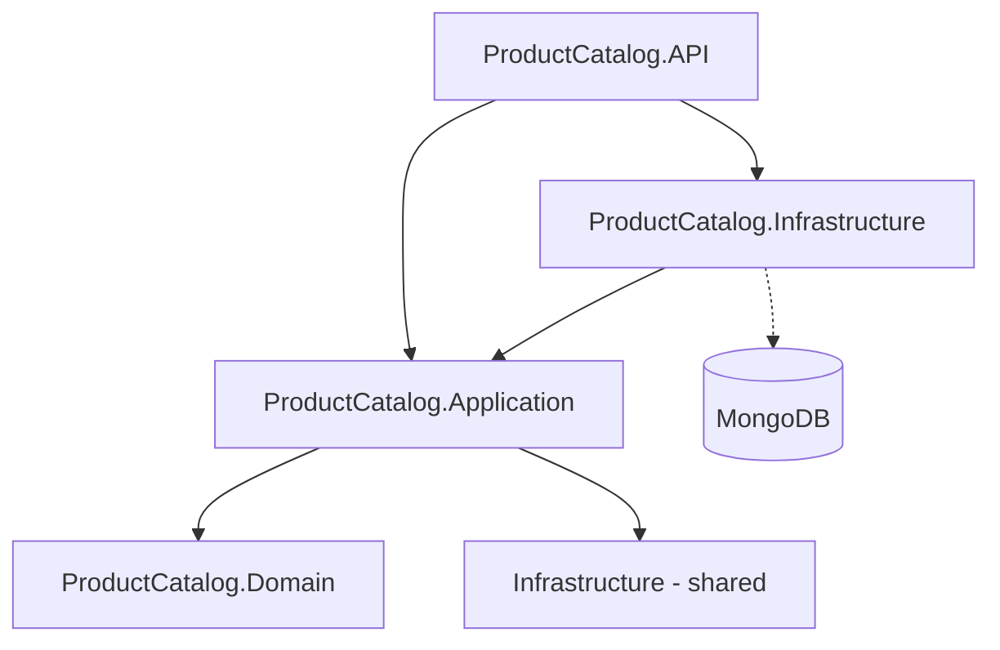
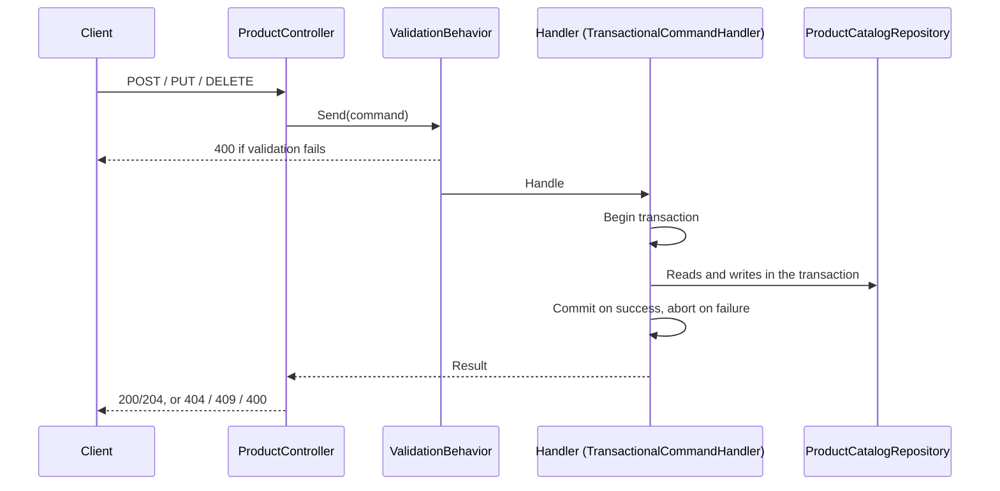

# Architecture

This document describes how the codebase is organised today and the conventions we follow when adding features. If something here disagrees with the code, the code wins; please fix the document.

## Overview

Shopee Microservices is a learning project modelled on the Shopee marketplace. So far there is a single service, **ProductCatalog**, which manages products as an SPU (the product itself) with one or more SKUs (the sellable variants), along with brands and product types.

The service is built with .NET 10 and ASP.NET Core controllers. It uses MediatR for commands and queries, FluentValidation, Mapster and Serilog, and stores its data in MongoDB 8, running as a single-node replica set (`rs0`) so transactions work. Docker Compose runs the API and the database together.

The [README](README.md) lists the technologies we plan to use eventually: more services, messaging, gRPC, other databases, a gateway, observability and CI. Most of that hasn't been built yet.

## Project layout

```text
ShopeeMicroservices/
├── ShopeeMicroservices.slnx
├── docker-compose.yml / docker-compose.override.yml   # catalogdb (mongo:8, --replSet rs0) + productcatalog.api (8000→8080)
├── Infrastructure/                       # shared building blocks used by every service
│   ├── Abstractions/Messaging/           # ICommand, IQuery, handler interfaces, Result, Error
│   ├── Abstractions/Behaviors/           # LoggingBehavior, ValidationBehavior, AddDefaultPipelineBehaviors()
│   └── Exceptions/                       # ValidationException, ValidationError
└── Services/ProductCatalog/
    ├── ProductCatalog.API/               # Program.cs, ProductController, middleware, Dockerfile, http/catalog.http
    ├── ProductCatalog.Application/
    │   ├── Handlers/<UseCase>Handler/    # one folder per command or query
    │   ├── Handlers/Base/                # TransactionalCommandHandler
    │   ├── Handlers/Common/              # IProductCommand, ProductSkuCommand (shared by create and update)
    │   ├── Validators/                   # FluentValidation validators
    │   ├── Errors/ProductErrors.cs       # business errors returned by handlers
    │   ├── Resources/ServerMessages.resx # user-facing messages
    │   ├── DTOs/, Mappers/               # requests, responses, entity → DTO mapping
    │   └── DependencyInjection.cs
    ├── ProductCatalog.Domain/            # entities, IProductCatalogRepository, IUnitOfWork
    └── ProductCatalog.Infrastructure/    # MongoDB repository, unit of work, indexes, seeding
```

Two projects are called "Infrastructure":
- `ShopeeMicroservices/Infrastructure` is the shared library of building blocks.
- `ProductCatalog.Infrastructure` is where the MongoDB code lives.

## Layers and dependencies

Each service is split into four projects in a Clean Architecture style. Requests go through MediatR as commands or queries. Commands and queries use the same repository and data model; there is no separate read store.



| Project | Depends on | Should not |
|---|---|---|
| Domain | `MongoDB.Driver` (BSON attributes, `IClientSessionHandle`), `MediatR.Contracts` | reference other layers or do I/O |
| Application | Domain, shared Infrastructure | reference ASP.NET Core or ProductCatalog.Infrastructure |
| Infrastructure | Application, Domain | contain business rules |
| API | Application, Infrastructure (wiring only) | call repositories or contain business rules |
| Shared Infrastructure | MediatR, FluentValidation, Mapster, Serilog | reference any service |

As a rule of thumb, here is where each kind of logic belongs:

| Logic | Where it goes |
|---|---|
| Entity invariants | `Create`/`Update` methods on the entities |
| Rules that can be checked from the request alone | Validators |
| Rules that need the database, and orchestration | Handlers |
| HTTP concerns | Controller |
| MongoDB details | Repository |

## Request pipeline and endpoints

`Program.cs` sets up the HTTP pipeline in this order:
1. Swagger (Development only)
2. HTTPS redirection
3. Correlation id logging
4. Serilog request logging
5. `ExceptionHandlingMiddleware`
6. Controllers

Inside MediatR, `AddDefaultPipelineBehaviors()` registers two behaviors:
1. `LoggingBehavior`
2. `ValidationBehavior`, which runs the validators for commands. A failed validation becomes a 400 response.

| Endpoint | Handler | Success | Errors |
|---|---|---|---|
| `POST /api/Product` | `CreateProductCommandHandler` | 200 | 400 (validation, unknown brand/category), 409 (SKU code taken) |
| `GET /api/Product` | `GetProductsQueryHandler` | 200 | — |
| `GET /api/Product/{id}` | `GetProductByIdQueryHandler` | 200 `ProductDetailsDto` | 404 |
| `PUT /api/Product/{id}` | `UpdateProductCommandHandler` | 204 | 400, 404, 409 |
| `DELETE /api/Product/{id}` | `DeleteProductCommandHandler` | 204 | 404 |

## How the main flows work

### Commands

Create, update and delete all follow the same path:



- **Create** checks that the brand and category exist and that none of the SKU codes belong to another product, then inserts the product and its SKUs.
- **Update** replaces the product details and the full list of SKUs. `ProductCode` can't be changed. SKUs are matched by `SkuCode`:
  - Existing SKUs that appear in the request are updated in place and keep their ids.
  - New codes are inserted.
  - SKUs left out of the request are deleted.
- **Delete** removes the product together with all of its SKUs.

### Queries

`GetProductById` loads the product. If it exists, it then loads the SKUs, brand and product type in parallel, and returns a `ProductDetailsDto` that includes the SKUs and the price range. `GetProducts` returns every product, without paging.

## Domain model

A `ProductSpu` has:
- a `ProductCode`, name, description and images
- a brand and a category (a `ProductType`)
- a list of `VariantOptions`, such as Color or Storage, each with its allowed values

A `ProductSku` belongs to a product through `SpuId`, and has its own code, price, image and `Attributes`: one value per variant option. SKUs are stored in their own collection rather than inside the product document.

The entities are simple classes with public setters. Business rules live in three places:
- **Entity methods.** `ProductSpu.Create` and `Update` require a name, brand and category. `Update` methods set `LastModified` and never change `ProductCode`, `SpuId` or `SkuCode`.
- **[`ProductCommandValidator`](ShopeeMicroservices/Services/ProductCatalog/ProductCatalog.Application/Validators/ProductCommandValidator.cs),** shared by create and update. It checks:
  - there is at least one SKU, prices are positive, and SKU codes are unique within the product
  - variant option codes and values are unique
  - every SKU has exactly one attribute per variant option, using one of that option's values
  - no two SKUs have the same combination of values, so a product without variant options can only have one SKU
- **The handlers,** for anything that needs the database: the brand and category must exist, and a SKU code can't already belong to another product.

## Persistence

Data lives in the `CatalogDb` database, in four collections: `ProductSpu`, `ProductSkus`, `Brands` and `Types`. The collection names come from `DatabaseSettings`. Ids are GUID v7 strings.

There is no "ignore extra elements" convention, so any document field without a matching property throws when it's read. Plain typed `Find` queries avoid that problem.

Writes go through transactions:
- `MongoUnitOfWork` starts a session per command and makes it available to the repository through `IMongoSessionAccessor`.
- The repository refuses to write outside a transaction.
- Inside a command handler, call the repository one step at a time. A MongoDB session can't be used by parallel calls. Queries don't use a session, so they can run in parallel.

At startup, `DatabaseIndexes` creates non-unique indexes on `ProductSkus.SpuId` and `ProductSkus.SkuCode`. `DatabaseSeeder` then fills empty collections from the JSON files in `Data/SeedData`. Seeded ids are different in every database, and every seeded product gets the first brand and type.

## Cross-cutting concerns

**Errors.** Handlers return `Result.Failure(...)` for expected problems instead of throwing, using `Error.NotFound` or one of the `ProductErrors`. `ProductController.CommandFailure` turns these into HTTP responses:
- not found → 404
- SKU code conflict → 409
- anything else → 400

Unexpected exceptions become a 500 in `ExceptionHandlingMiddleware`.

**Messages.** User-facing validation and error messages live in [`ServerMessages.resx`](ShopeeMicroservices/Services/ProductCatalog/ProductCatalog.Application/Resources/ServerMessages.resx). Visual Studio regenerates `ServerMessages.Designer.cs` whenever the file is edited.
- Look messages up when they're used, so they follow the current culture: `WithMessage(_ => ServerMessages.X)` in validators, and properties in `ProductErrors`.
- Fill placeholders with `string.Format(CultureInfo.CurrentCulture, ...)`.

**Logging.** Serilog reads its settings from configuration, but `appsettings.json` doesn't have a `Serilog` section yet, so nothing is written anywhere. To see logs locally, set these two environment variables:
- `Serilog__Using__0=Serilog.Sinks.Console`
- `Serilog__WriteTo__0__Name=Console`

**Authentication.** Not implemented yet; all endpoints are open.

**API contract.** Requests use the domain types `VariantOption` and `SkuAttribute` directly. A SKU attribute looks like `{ "attributeCode": "color", "value": "Black" }`, where `attributeCode` matches the code of one of the variant options.

## Adding a feature

1. **Create a handler folder.** Add `Handlers/<UseCase>Handler/` with the command or query and its handler.
2. **Commands:**
   - Inherit from `TransactionalCommandHandler`.
   - Return `Result.Failure(...)` for business errors.
   - Add a validator in `Validators/`.
   - Put new messages in `ServerMessages.resx`.
3. **Queries** return DTOs, never entities.
4. **Keep controllers thin:**
   - Map the request with Mapster.
   - Pass the `CancellationToken` to `_mediator.Send`.
   - Use `CommandFailure` for errors.
5. **New repository methods** should pass the `CancellationToken` through to the driver.
6. **Before you open a PR:**
   - Build the solution.
   - Try the endpoint with [`catalog.http`](ShopeeMicroservices/Services/ProductCatalog/ProductCatalog.API/http/catalog.http), including the error cases.
   - Update this document if you changed a convention.

## Known issues

- **SKU codes aren't unique in the database yet.** Older development data may already contain duplicates, so the `SkuCode` index is still non-unique. The handlers reject duplicates, but two simultaneous requests could still get through.
- **`ProductCode` isn't unique either**, and there is no optimistic concurrency, so the last update wins.
- **`GET /api/Product` returns the whole `Result` object** (`value`, `isSuccess`, `error`) instead of just the data.
- **`BaseEntity` sets `Id` and `CreatedDate` in its constructor**, which also runs when documents are loaded. A document without `CreatedDate` comes back with the current time.
- **There are no tests or CI pipelines yet.**
- **Seeded ids differ per database.** Update the variables at the top of `catalog.http` before using it.
- **The Docker build context is `ShopeeMicroservices/`.** When the API references a new project, add a `COPY` line for its `.csproj` to the [`Dockerfile`](ShopeeMicroservices/Services/ProductCatalog/ProductCatalog.API/Dockerfile).
- **Some code is unused for now:**
  - `Repository<T>`
  - `IProductCatalogQueryService`
  - `ConcurrencyException`
  - `Aggregate<T>` and domain events
  - `Inventory`
  - the brand/type lookups by name

## Quick reference

| Task | Start from |
|---|---|
| Add a command endpoint | [`UpdateProductCommandHandler`](ShopeeMicroservices/Services/ProductCatalog/ProductCatalog.Application/Handlers/UpdateProductCommandHandler/UpdateProductCommandHandler.cs) |
| Add a query endpoint | [`GetProductByIdQueryHandler`](ShopeeMicroservices/Services/ProductCatalog/ProductCatalog.Application/Handlers/GetProductByIdQueryHandler/GetProductByIdQueryHandler.cs) |
| Add validation | [`UpdateProductCommandValidator`](ShopeeMicroservices/Services/ProductCatalog/ProductCatalog.Application/Validators/UpdateProductCommandValidator.cs) |
| Add a business error | [`ProductErrors`](ShopeeMicroservices/Services/ProductCatalog/ProductCatalog.Application/Errors/ProductErrors.cs) + `ServerMessages.resx` |
| Add a repository method | [`ProductCatalogRepository`](ShopeeMicroservices/Services/ProductCatalog/ProductCatalog.Infrastructure/Repositories/ProductCatalogRepository.cs) |
| Add an index | [`DatabaseIndexes`](ShopeeMicroservices/Services/ProductCatalog/ProductCatalog.Infrastructure/Data/DatabaseIndexes.cs) |

**Build and run** (from the repo root):

```bash
dotnet build ShopeeMicroservices/ShopeeMicroservices.slnx
```

```bash
dotnet run --project ShopeeMicroservices/Services/ProductCatalog/ProductCatalog.API
```

**Running the API outside Docker against the Compose database.** Use this connection string:
- `DatabaseSettings__ConnectionString=mongodb://localhost:27017/?directConnection=true`

The replica set member is registered as `catalogdb:27017`, a hostname that only exists inside Docker.

**First Compose run.** Initialise the replica set once:

```bash
docker exec catalogdb mongosh --eval "rs.initiate({_id:'rs0',members:[{_id:0,host:'catalogdb:27017'}]})"
```

## What's next

1. Clean up duplicate SKU codes, then make the `SkuCode` index unique, and add a unique index on `ProductCode`.
2. Return plain DTOs from `GET /api/Product` and add paging.
3. Move `Id`/`CreatedDate` assignment out of the `BaseEntity` constructor.
4. Add optimistic concurrency for product updates.
5. Add tests and a CI pipeline.
6. Configure Serilog sinks.
