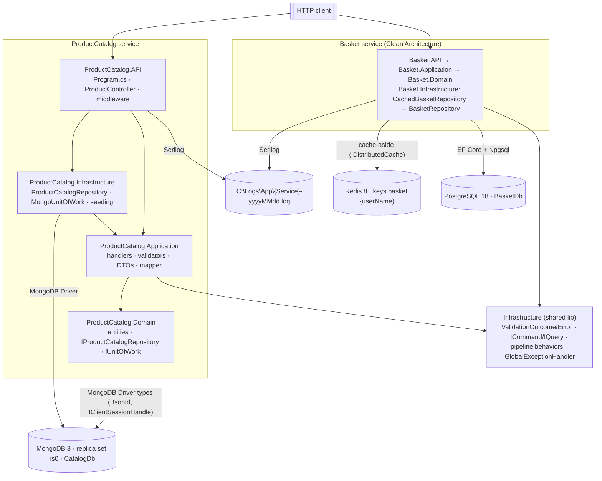
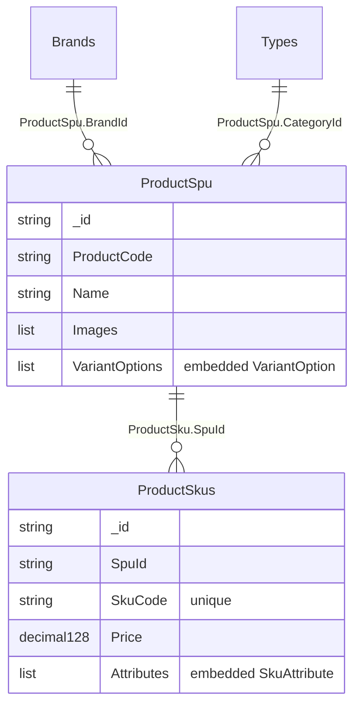
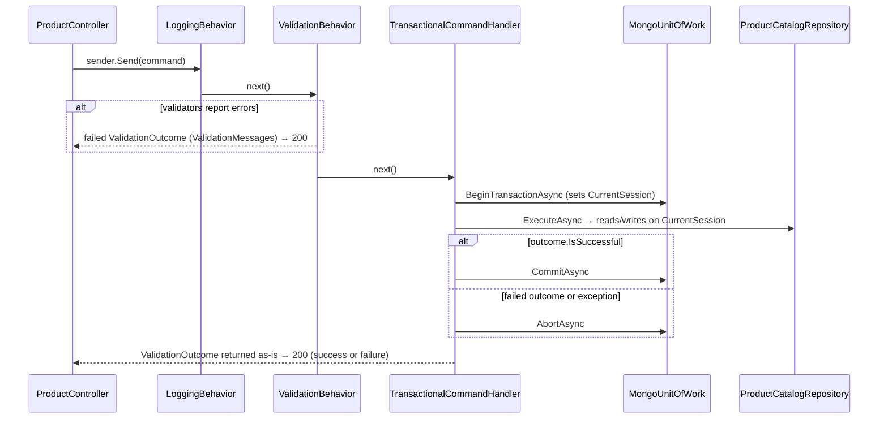

# ARCHITECTURE.md — ShopeeMicroservices

> Index into the source, not a replacement for it. Path convention: `ProductCatalog.*/…` = `Services/ProductCatalog/ProductCatalog.*/…`; `Basket.*/…` = `Services/Basket/Basket.*/…`; `Infrastructure/…` = the **shared** library at repo root (not `ProductCatalog.Infrastructure` / `Basket.Infrastructure`).
> Verified against source on 2026-11-15.

## A. Project Identity

- **Purpose:** E-commerce backend. Two independent services (no calls between them): **ProductCatalog** (products = SPU, variants = SKU, brands, types) and **Basket** (one shopping cart per user name).
- **Type:** ASP.NET Core Web APIs (`net10.0`) with controllers + Swagger (Development only).
- **Tech:** MediatR 14 (CQRS), FluentValidation 12, Serilog (Console + daily rolling file), Docker Compose. ProductCatalog: Mapster 10, MongoDB.Driver 3.10 (MongoDB 8, replica set `rs0`). Basket: EF Core 10 + Npgsql (PostgreSQL 18), Redis 8 via `IDistributedCache`.
- **Style:** both services = **Clean Architecture** with the same 4-project layout (`*.API` → `*.Application` → `*.Domain`; `*.Infrastructure` implements the Domain/Application ports). Both use CQRS via MediatR + the `ValidationOutcome` pattern from the shared `Infrastructure/` library.
- **Entry points:** `ProductCatalog.API/Program.cs` (`ProductController`, 5 CRUD endpoints) and `Basket.API/Program.cs` (`BasketController`, `/basket/{userName}` GET/PUT/DELETE). See I.
- **Key traits:** ProductCatalog command handlers run in a MongoDB multi-document transaction (`TransactionalCommandHandler`); Basket reads go through a Redis cache-aside decorator (`CachedBasketRepository`); every endpoint answers **200** with the handler's `ValidationOutcome` / `Validation<T>` as body — business errors, `not found` and validator failures are `isSuccessful: false` + `validationMessages`, never a status code; only unexpected exceptions become 500 `ProblemDetails` in the shared `GlobalExceptionHandler`; each service creates its database on first start; no auth, no messaging, no tests.

## B. Repository Map

| Path | Responsibility | Key Symbols |
|---|---|---|
| `ShopeeMicroservices.slnx` | Solution (6 projects + `docker-compose.dcproj`) | — |
| `docker-compose.yml`, `docker-compose.override.yml` | Containers + env config: `catalogdb` (Mongo), `productcatalog.api`, `basketdb` (PostgreSQL), `distributedcache` (Redis), `basket.api` | service names |
| `Infrastructure/Abstractions/Messaging/` | Shared CQRS request/handler contracts | `ICommand`, `IQuery`, `ICommandHandler`, `IQueryHandler` |
| `Infrastructure/Errors/` | Outcome types returned by every handler and sent as the 200 body | `ValidationOutcome`, `Validation<T>`, `ValidationMessages`, `Error` |
| `Infrastructure/Abstractions/Behaviors/` | Shared MediatR pipeline | `LoggingBehavior`, `ValidationBehavior`, `AddDefaultPipelineBehaviors` |
| `Infrastructure/Exceptions/` | Unexpected-error handling for every service (needs the `Microsoft.AspNetCore.App` framework reference) | `GlobalExceptionHandler`, `AddGlobalExceptionHandler`, `OptimisticLockingException` |
| `ProductCatalog.API/` | HTTP host, composition root, middleware | `Program.cs`, `ProductController`, `RequestContextLoggingMiddleware` |
| `ProductCatalog.API/http/catalog.http` | Manual HTTP samples (happy path for each endpoint) using seeded ids | — |
| `ProductCatalog.Application/Handlers/` | One folder per use case (command/query + handler) | `*CommandHandler`, `*QueryHandler`, `TransactionalCommandHandler` |
| `ProductCatalog.Application/Validators/` | FluentValidation rules | `ProductCommandValidator` (shared), `Create/Update/DeleteProductCommandValidator` |
| `ProductCatalog.Application/DTOs/`, `ProductCatalog.Application/Mappers/` | Request/response contracts, entity→DTO mapping | `CreateProductRequest`, `ProductDetailsDto`, `ProductCatalogMapper` |
| `ProductCatalog.Application/Errors/`, `ProductCatalog.Application/Resources/` | Business errors + localizable messages (resx) | `ProductErrors`, `ServerMessages` |
| `ProductCatalog.Domain/Entities/` | Mongo-mapped domain entities | `ProductSpu`, `ProductSku`, `ProductBrand`, `ProductType`, `BaseEntity` |
| `ProductCatalog.Domain/Abstractions/`, `ProductCatalog.Domain/Repositories/` | Ports + base types | `IUnitOfWork`, `IProductCatalogRepository`, `Entity<T>` |
| `ProductCatalog.Infrastructure/Repositories/` | Mongo persistence + transaction | `ProductCatalogRepository`, `MongoUnitOfWork`, `IMongoSessionAccessor` |
| `ProductCatalog.Infrastructure/Data/` | First-run database setup (seed + indexes) | `DatabaseInitializer`, `DatabaseSeeder`, `DatabaseIndexes`, `CatalogSeedData` |
| `Basket.API/` | HTTP host, composition root | `Program.cs`, `BasketController` |
| `Basket.API/http/basket.http` | Manual HTTP samples (happy path) | — |
| `Basket.Application/Handlers/` | One folder per use case (command/query + handler) | `GetBasketQueryHandler`, `StoreBasketCommandHandler`, `DeleteBasketCommandHandler` |
| `Basket.Application/Validators/`, `Basket.Application/DTOs/`, `Basket.Application/Mappers/`, `Basket.Application/Resources/` | Validators, request/response DTOs, entity↔DTO mapping, messages (resx) | `StoreBasketCommandValidator`, `ShoppingCartDto`, `BasketMapper`, `ServerMessages` |
| `Basket.Domain/` | Entities + repository port (no package references) | `ShoppingCart`, `ShoppingCartItem`, `IBasketRepository` |
| `Basket.Infrastructure/` | EF Core/PostgreSQL store, Redis cache-aside decorator, DI, DB creation | `BasketDbContext`, `BasketRepository`, `CachedBasketRepository`, `AddInfrastructure`, `DatabaseInitializer` |

## C. Architecture Overview



Project references (csproj-verified), identical shape in both services: `*.API` → `*.Application`, `*.Infrastructure`; `*.Infrastructure` → `*.Application`; `*.Application` → `*.Domain`, shared `Infrastructure`. `Basket.Domain` has no package references (EF mapping lives in `BasketDbContext`); `ProductCatalog.Domain` references `MongoDB.Driver`. The two services share no code besides `Infrastructure/` and do not call each other. No circular dependencies.

## D. Module Index

| Module | Responsibility | Entry Point / Public Interface | Dependencies | Source |
|---|---|---|---|---|
| API host | DI composition, BSON serializer registration, startup index+seed, middleware pipeline | `Program.cs`; `AddApplication()`, `AddInfrastructure()` | Application, PC.Infrastructure, Serilog, Swashbuckle | `ProductCatalog.API/Program.cs` |
| Product endpoints | HTTP → MediatR; each action returns `sender.Send(...)` as `Task<Validation<T>>` / `Task<ValidationOutcome>` (the 200 body) — no `IActionResult` | `ProductController` | `ISender`, Mapster `Adapt<T>()` | `ProductCatalog.API/Controllers/ProductController.cs` |
| Responses (shared, both services) | **Every handler outcome** is returned as-is → **200**: success `{ "value": …, "isSuccessful": true, "validationMessages": null }`, failure `{ "value": null, "isSuccessful": false, "validationMessages": { "messages": [...] } }` (no `value` for `ValidationOutcome`). Only **unexpected exceptions** → `GlobalExceptionHandler` → 500 `ProblemDetails` (`application/problem+json`, `traceId`); `OptimisticLockingException` → 200 failure with `Error.OptimisticLocking` | controller action return type `Task<Validation<T>>` / `Task<ValidationOutcome>`; `AddGlobalExceptionHandler()` + `app.UseExceptionHandler()` | ASP.NET Core `IProblemDetailsService`, `IExceptionHandler` | `Infrastructure/Errors/`, `Infrastructure/Exceptions/` |
| Correlation logging | Pushes `CorrelationId` (header `X-Correlation-Id` or `TraceIdentifier`) to Serilog `LogContext` | `RequestContextLoggingMiddleware` | Serilog (`Enrich: FromLogContext`) | `ProductCatalog.API/Middleware/RequestContextLoggingMiddleware.cs` |
| CQRS kernel (shared) | Request markers, `ValidationOutcome`/`Error`, logging + validation behaviors | `ICommand`/`ICommand<T>`/`IQuery<T>`, `AddDefaultPipelineBehaviors()` | MediatR, FluentValidation, Serilog | `Infrastructure/Abstractions/`, `Infrastructure/Errors/` |
| Product use cases | Create/Update/Delete (transactional), GetById, GetAll | handlers in `ProductCatalog.Application/Handlers/<UseCase>/` | `IProductCatalogRepository`, `IUnitOfWork`, `IDateTimeProvider` | `ProductCatalog.Application/Handlers/` |
| Transaction template | Begin tx → `ExecuteAsync` → commit on success / abort on failure or exception | `TransactionalCommandHandler<TCommand[,TResponse]>` | `IUnitOfWork` | `ProductCatalog.Application/Handlers/Base/TransactionalCommandHandler.cs` |
| Validation rules | Product body + SKU/variant consistency rules, shared by create & update via `IProductCommand` | `ProductCommandValidator` (internal), `Include()`d by Create/Update validators | `VariantKeyBuilder`, `ServerMessages` | `ProductCatalog.Application/Validators/` |
| Domain model | Entities with factory/update methods enforcing required fields | `ProductSpu.Create/Update`, `ProductSku.Create/Update` | MongoDB.Bson attributes | `ProductCatalog.Domain/Entities/` |
| Persistence | Mongo collections, session-aware reads; writes **require** active tx session | `ProductCatalogRepository : IProductCatalogRepository` | `IMongoClient`, `IMongoSessionAccessor`, `DatabaseSettings` | `ProductCatalog.Infrastructure/Repositories/ProductCatalogRepository.cs` |
| Unit of work | Owns the `IClientSessionHandle` per DI scope; exposes it to repositories | `MongoUnitOfWork : IUnitOfWork, IMongoSessionAccessor` | `IMongoClient` | `ProductCatalog.Infrastructure/Repositories/MongoUnitOfWork.cs` |
| Startup data | Only if `DatabaseName` does not exist: seed `CatalogSeedData`, then create indexes; an existing database is never touched | `DatabaseInitializer.InitializeAsync` (`DatabaseIndexes` is internal) | DI `IMongoClient` | `ProductCatalog.Infrastructure/Data/` |
| Basket use cases | `GetBasket` (query), `StoreBasket` (command, replaces the whole basket), `DeleteBasket` (command); responses are DTOs | handlers in `Basket.Application/Handlers/<UseCase>Handler/`, exposed by `BasketController` | `IBasketRepository`, `BasketMapper` | `Basket.Application/Handlers/`, `Basket.API/Controllers/BasketController.cs` |
| Basket persistence | PostgreSQL row per user (items in `jsonb`), wrapped by a Redis cache-aside decorator; handlers only see the Domain port `IBasketRepository` | `IBasketRepository` → `CachedBasketRepository` → `BasketRepository` | `BasketDbContext`, `IDistributedCache` | `Basket.Domain/Repositories/`, `Basket.Infrastructure/` |

## E. Symbol Index

| Symbol | Type | File | Purpose |
|---|---|---|---|
| `ProductController` | Controller | `ProductCatalog.API/Controllers/ProductController.cs` | 5 endpoints under `api/Product` |
| `GlobalExceptionHandler` | `IExceptionHandler` | `Infrastructure/Exceptions/GlobalExceptionHandler.cs` | `OptimisticLockingException` → logged at Warning, **200** `ValidationOutcome.Failure(Error.OptimisticLocking)`; anything else → logged at Error with the exception, **500** `ProblemDetails` (title `Server error`, generic detail). No other mapping: e.g. minimal-API `BadHttpRequestException` (malformed JSON, Development) also becomes 500 |
| `OptimisticLockingException` | Exception | `Infrastructure/Exceptions/OptimisticLockingException.cs` | The only exception that becomes a user message. Nothing throws it yet (entities have no version field) |
| `AddGlobalExceptionHandler` | DI ext | `Infrastructure/Exceptions/ExceptionHandlingExtensions.cs` | `AddExceptionHandler<GlobalExceptionHandler>()` + `AddProblemDetails()` |
| `AddApplication()` | DI ext | `ProductCatalog.Application/DependencyInjection.cs` | MediatR + behaviors + validators from assembly |
| `AddInfrastructure()` | DI ext | `ProductCatalog.Infrastructure/DependencyInjection.cs` | `IMongoClient` (singleton), UoW/repo (scoped), clock, `mongodb` health check (`AddMongoDb`, same client + `DatabaseName`) |
| `AddDefaultPipelineBehaviors()` | Ext | `Infrastructure/Abstractions/Behaviors/MediatRConfigurationExtensions.cs` | Registers Logging → Validation (order matters) |
| `ValidationBehavior<,>` | Pipeline | `Infrastructure/Abstractions/Behaviors/ValidationBehavior.cs` | Commands only (`IBaseCommand`; `TResponse : ValidationOutcome, new()`); on failure **returns** `new TResponse { ValidationMessages = ... }` (handler not called) → 200 `isSuccessful: false`. Error code = FluentValidation `ErrorCode` ?? property name |
| `LoggingBehavior<,>` | Pipeline | `Infrastructure/Abstractions/Behaviors/LoggingBehavior.cs` | Logs start/success; failed outcomes at Warning with `ValidationMessages`; exceptions at Error and rethrows |
| `ValidationOutcome`, `Validation<T>`, `ValidationMessages`, `Error` | Types | `Infrastructure/Errors/` | `IsSuccessful` = no `ValidationMessages`; `Validation<T>.Value` (`null` on failure); `ValidationMessages` holds `Error`s but serializes only `messages` (strings, codes are not sent); `Error(Code, Message)` with `Error.NullValue/NotFound/OptimisticLocking`; implicit `Error` → failed outcome and `TValue` → `Validation<T>` (a `null` value becomes `Error.NullValue`). All public properties are the 200 JSON body |
| `TransactionalCommandHandler<,>` | Abstract class | `ProductCatalog.Application/Handlers/Base/TransactionalCommandHandler.cs` | Tx template; override `ExecuteAsync` |
| `CreateProductCommandHandler` | Handler | `ProductCatalog.Application/Handlers/CreateProductCommandHandler/` | Validate refs + SKU codes, insert SPU then SKUs |
| `UpdateProductCommandHandler` | Handler | `ProductCatalog.Application/Handlers/UpdateProductCommandHandler/` | Replace SPU; diff SKUs by `SkuCode` |
| `DeleteProductCommandHandler` | Handler | `ProductCatalog.Application/Handlers/DeleteProductCommandHandler/` | Delete SKUs then SPU |
| `GetProductByIdQueryHandler` | Handler | `ProductCatalog.Application/Handlers/GetProductByIdQueryHandler/` | SPU + parallel SKUs/brand/type reads → `ProductDetailsDto` |
| `GetProductsQueryHandler` | Handler (record) | `ProductCatalog.Application/Handlers/GetProductQueryHandler/` | All SPUs → `GetProductsQueryResult` |
| `IProductCommand`, `ProductSkuCommand` | Interface/record | `ProductCatalog.Application/Handlers/Common/` | Shared create/update body |
| `ProductCommandValidator` | Validator | `ProductCatalog.Application/Validators/ProductCommandValidator.cs` | Uniqueness + SKU↔variant consistency rules |
| `VariantKeyBuilder.Build` | Util | `ProductCatalog.Application/Utils/VariantKeyBuilder.cs` | Normalized attribute-combination key |
| `ProductErrors` | Static class | `ProductCatalog.Application/Errors/ProductErrors.cs` | Code constants `BrandNotFoundCode`, `CategoryNotFoundCode`, `SkuCodeConflictCode`; `static readonly` `BrandNotFound`, `CategoryNotFound`; method `SkuCodeConflict(skuCodes)` |
| `ProductCatalogMapper` | Ext methods | `ProductCatalog.Application/Mappers/ProductCatalogMapper.cs` | Entity → DTO; `ToDetailsDto` computes `MinPrice`/`MaxPrice` |
| `ServerMessages` | Generated resx | `ProductCatalog.Application/Resources/ServerMessages.resx` (+`.Designer.cs`) | Error/validation message text |
| `IDateTimeProvider` / `DateTimeProvider` | Port/impl | `ProductCatalog.Application/Abstractions/Clock/`, `ProductCatalog.Infrastructure/Clock/` | `UtcNow` for `LastModified` |
| `ProductSpu`, `VariantOption` | Entity | `ProductCatalog.Domain/Entities/ProductSpu.cs` | Product; `ProductCode` immutable after create |
| `ProductSku`, `SkuAttribute` | Entity | `ProductCatalog.Domain/Entities/ProductSku.cs` | Variant; `SpuId`/`SkuCode` immutable; `Price` as Decimal128 |
| `BaseEntity` / `Entity<T>` | Base | `ProductCatalog.Domain/Entities/BaseEntity.cs`, `ProductCatalog.Domain/Abstractions/Entity.cs` | `Id = Guid.CreateVersion7().ToString()`, audit fields |
| `IProductCatalogRepository` | Port | `ProductCatalog.Domain/Repositories/IProductCatalogRepository.cs` | Only repository abstraction |
| `IUnitOfWork` | Port | `ProductCatalog.Domain/Abstractions/IUnitOfWork.cs` | Begin/Commit/Abort (Mongo session type leaks into Domain) |
| `ProductCatalogRepository` | Repository | `ProductCatalog.Infrastructure/Repositories/ProductCatalogRepository.cs` | `WriteSession` guard; `Find<T>` joins tx if active |
| `MongoUnitOfWork` | UoW | `ProductCatalog.Infrastructure/Repositories/MongoUnitOfWork.cs` | `CurrentSession` lifecycle |
| `DatabaseInitializer.InitializeAsync` | Static method | `ProductCatalog.Infrastructure/Data/DatabaseInitializer.cs` | Startup entry: `ListDatabaseNames` check → `DatabaseSeeder.SeedAsync` → `DatabaseIndexes.EnsureAsync` |
| `CatalogSeedData` | Static class | `ProductCatalog.Infrastructure/Data/CatalogSeedData.cs` | Sample brands/types/products with fixed ids (`AppleBrandId`, `SmartphoneTypeId`, …) |
| `DatabaseSettings` | Options | `ProductCatalog.Infrastructure/Settings/DatabaseSettings.cs` | Connection + collection names |
| `ShoppingCart`, `ShoppingCartItem` | Entities | `Basket.Domain/Entities/` | Key `UserName`; `TotalPrice` computed (not stored); item = `ProductId`, `SkuCode`, `ProductName`, `Price`, `Quantity` (refers to ProductCatalog ids/codes; not checked). EF entity + Redis payload; never returned by the API |
| `GetBasketQuery` / `GetBasketQueryHandler` | Query + handler | `Basket.Application/Handlers/GetBasketQueryHandler/` | `ShoppingCartDto` or `Error.NotFound` |
| `StoreBasketCommand` / `StoreBasketCommandHandler` | Command + handler | `Basket.Application/Handlers/StoreBasketCommandHandler/` | Upsert: maps item DTOs → entities, `StoreBasketAsync`, returns `ShoppingCartDto`. No unit of work (single-row `SaveChanges`) |
| `StoreBasketRequest`, `ShoppingCartDto`, `ShoppingCartItemDto` | DTOs | `Basket.Application/DTOs/` | Request body `{ items: [...] }` (user name from the route: `Adapt<StoreBasketCommand>() with { UserName }`); response includes `TotalPrice` |
| `DeleteBasketCommand` / `DeleteBasketCommandHandler` | Command + handler | `Basket.Application/Handlers/DeleteBasketCommandHandler/` | `Error.NotFound` when nothing was deleted |
| `StoreBasketCommandValidator`, `DeleteBasketCommandValidator` | Validators | `Basket.Application/Validators/` | Item fields required, `Price`/`Quantity` > 0, `SkuCode` unique per basket (`ServerMessages.SkuCodesNotUnique`); empty item list allowed |
| `BasketMapper` | Ext methods | `Basket.Application/Mappers/BasketMapper.cs` | `ShoppingCart.ToDto()`, `ShoppingCartItemDto.ToEntity()` |
| `BasketController` | Controller | `Basket.API/Controllers/BasketController.cs` | `[Route("basket")]`; same rules as `ProductController` (returns `Validation<T>`/`ValidationOutcome`, class-level 200 + 500 only) |
| `IBasketRepository` | Port | `Basket.Domain/Repositories/IBasketRepository.cs` | `GetBasketAsync`, `StoreBasketAsync` (upsert), `DeleteBasketAsync` (bool) |
| `BasketRepository` | Repository | `Basket.Infrastructure/Repositories/BasketRepository.cs` | EF Core: no-tracking read; upsert = load + replace `Items` (or add) + `SaveChanges`; `ExecuteDeleteAsync` |
| `CachedBasketRepository` | Decorator | `Basket.Infrastructure/Repositories/CachedBasketRepository.cs` | Cache-aside: read → Redis, miss → DB + cache (30 min sliding); store/delete → DB, then remove the cache key |
| `BasketDbContext` | DbContext | `Basket.Infrastructure/Data/BasketDbContext.cs` | `ShoppingCarts` table, PK `UserName`, `Items` owned collection `ToJson()` → `jsonb` |
| `AddInfrastructure` (Basket) / `DatabaseInitializer.InitializeAsync` | DI ext / static | `Basket.Infrastructure/DependencyInjection.cs`, `Basket.Infrastructure/Data/DatabaseInitializer.cs` | DbContext, Redis cache (`InstanceName` `basket:`), decorator wiring, `npgsql` + `redis` health checks; `EnsureCreatedAsync` at startup |

## F. Dependency Index

```text
ProductController -> ISender -> LoggingBehavior -> ValidationBehavior (commands only) -> handler
  CreateProductCommand  -> CreateProductCommandHandler  -> TransactionalCommandHandler -> IUnitOfWork
                                                        -> IProductCatalogRepository
  UpdateProductCommand  -> UpdateProductCommandHandler  -> (same) + IDateTimeProvider
  DeleteProductCommand  -> DeleteProductCommandHandler  -> (same)
  GetProductByIdQuery   -> GetProductByIdQueryHandler   -> IProductCatalogRepository, ProductCatalogMapper
  GetProductsQuery      -> GetProductsQueryHandler      -> IProductCatalogRepository, ProductCatalogMapper

IUnitOfWork, IMongoSessionAccessor  => same scoped MongoUnitOfWork instance -> IMongoClient (singleton)
IProductCatalogRepository => ProductCatalogRepository -> IMongoClient, IMongoSessionAccessor, IOptions<DatabaseSettings>
Program.cs -> DatabaseInitializer.InitializeAsync -> DatabaseSeeder (-> CatalogSeedData), DatabaseIndexes   (DI IMongoClient)

Basket (same layering):
BasketController -> ISender -> LoggingBehavior -> ValidationBehavior (commands only) -> <UseCase>Handler -> BasketMapper
  -> IBasketRepository => CachedBasketRepository (scoped) -> IDistributedCache (Redis)
                                                    -> BasketRepository (scoped) -> BasketDbContext (Npgsql)
Program.cs -> DatabaseInitializer.InitializeAsync -> BasketDbContext.Database.EnsureCreatedAsync
```

Shared dependencies: `ValidationOutcome`/`Error` (all handlers of both services, `ProductController`, `BasketController`, `LoggingBehavior`, `ValidationBehavior`); `DatabaseSettings` (repository, indexes, seeder, `IMongoClient` factory). Circular: none.

## G. Data Architecture Index



- **Store:** MongoDB DB `CatalogDb`; collection names from `DatabaseSettings` (`ProductSpu`, `ProductSkus`, `Brands`, `Types`). No FK enforcement — referential checks done in handlers (`GetBrandByIdAsync`, `GetCategoryByIdAsync`).
- **Ids:** string GUID v7 (sortable → `GetSkusByProductIdAsync` sorts by `Id` for creation order). Audit fields `CreatedDate/CreatedBy/LastModified/LastModifiedBy` on `Entity<T>`; `CreatedBy`/`LastModifiedBy` are never set. `Id` and `CreatedDate` are assigned in the `BaseEntity` constructor (`DateTime.UtcNow`, not `IDateTimeProvider`).
- **Serialization:** global `GuidSerializer(BsonType.String)`, `DateTimeOffsetSerializer(BsonType.String)` in `Program.cs`; `[BsonRepresentation(Decimal128)]` on `ProductSku.Price`.
- **Indexes:** `DatabaseIndexes.EnsureAsync` — `ProductSkus.SpuId`; `ProductSkus.SkuCode` **unique**. No index on `ProductSpu.ProductCode`. Created only for a new database (see Seed).
- **Migrations:** none (schemaless). **Caching:** none.
- **Seed:** `CatalogSeedData` (in code, no JSON). `DatabaseInitializer` runs only when `DatabaseName` is missing from `ListDatabaseNames` (MongoDB creates a database on its first write): `DatabaseSeeder` first (brands and types inserted directly; products + SKUs in one `WithTransactionAsync`), then indexes. A failure after brands are inserted leaves the database existing but partly seeded, and later starts skip it — drop `CatalogDb` to re-run. Index or seed changes reach only new databases. All 8 sample iPhones use `AppleBrandId` + `SmartphoneTypeId`.
- **Basket (PostgreSQL `BasketDb`):** table `ShoppingCarts` (`UserName` text PK, `Items` jsonb) from `BasketDbContext`. Created by `EnsureCreatedAsync` on startup when the database or its tables are missing; **no EF migrations** — a model change needs the table dropped (or a switch to migrations). Store = full replace of `Items`.
- **Basket cache (Redis):** key `basket:<userName>` (`InstanceName` + user name), value = `ShoppingCart` as System.Text.Json, 30-minute sliding expiration. Written only on a read miss; removed after every store/delete. Database is the source of truth.
- **DTOs:** requests `CreateProductRequest`, `UpdateProductRequest`, `ProductSkuRequest`; responses `ProductSpuDto`(+`VariantOptionDto`), `ProductSkuDto`(+`SkuAttributeDto`), `ProductBrandDto`, `ProductTypeDto`, `ProductDetailsDto` — all in `ProductCatalog.Application/DTOs/`. Requests embed domain types `VariantOption`/`SkuAttribute` directly.

## H. Execution Flow Index

**Command pipeline (all writes)**



| Workflow | Entry | Sequence (after pipeline) | Side effects / Output |
|---|---|---|---|
| Create product | `POST api/Product` → `CreateProductRequest.Adapt<CreateProductCommand>()` | brand exists? → category exists? → `GetSkusByCodesAsync` (any hit = `SkuCodeConflict`) → `ProductSpu.Create` → `CreateProductAsync` → `ProductSku.Create`×n → `CreateSkusAsync` | 1 SPU + n SKU docs in one tx; `200 {}` (`CreateProductResult` is empty — no id returned) |
| Update product | `PUT api/Product/{id}` → `Adapt<UpdateProductCommand>() with { Id = id }` | load SPU (`Error.NotFound`) → brand/category checks → SKU-code conflict excluding own `SpuId` → `product.Update` → match existing SKUs by `SkuCode`: matched→`Update`, unmatched existing→delete, new codes→create → `UpdateProductAsync`, `UpdateSkusAsync` (BulkWrite replace), `CreateSkusAsync`, `DeleteSkusAsync` | Full replace of body + SKU set; kept SKUs keep `Id`; `isSuccessful: true`, no value |
| Delete product | `DELETE api/Product/{id}` | load SPU (`Error.NotFound`) → `DeleteSkusByProductIdAsync` → `DeleteProductAsync` | `isSuccessful: true`, no value |
| Get by id | `GET api/Product/{id}` (query: no validation, no tx) | `GetProductByIdAsync` → `Task.WhenAll`(SKUs, brand, type) → `ToDetailsDto` | `ProductDetailsDto` with min/max price |
| List | `GET api/Product` | `GetAllAsync` (no paging, no filter) → `ToDtoList` | `GetProductsQueryResult` |
| Startup | `Program.cs` | `DatabaseInitializer.InitializeAsync` (only for a missing database: seed → indexes) → middleware: `UseHttpsRedirection` → `UseRequestContextLogging` → `UseSerilogRequestLogging` → `UseExceptionHandler` → `MapControllers` → `MapHealthChecks("/health")` | Seed data + indexes on first run; runs before `app.Run()`, so an unreachable MongoDB fails startup |
| Get basket | `GET /basket/{userName}` | `CachedBasketRepository.GetBasketAsync`: Redis hit → return; miss → `BasketRepository` (no-tracking) → cache it → `ToDto` | `ShoppingCartDto` with `TotalPrice`; `Error.NotFound` if none |
| Store basket | `PUT /basket/{userName}` → `StoreBasketRequest.Adapt<StoreBasketCommand>() with { UserName }` | validator → items `ToEntity` → `BasketRepository.StoreBasketAsync` (insert, or replace `Items` of the tracked row) → remove Redis key → `ToDto` | Stored basket |
| Delete basket | `DELETE /basket/{userName}` | `ExecuteDeleteAsync` → remove Redis key | `isSuccessful: true`, no value; `Error.NotFound` if nothing deleted |
| Basket startup | `Basket.API/Program.cs` | `DatabaseInitializer.InitializeAsync` (`EnsureCreatedAsync`; skipped under the Swashbuckle CLI) → Swagger (Development) → `UseHttpsRedirection` → `UseSerilogRequestLogging` → `UseExceptionHandler` → `MapControllers` → `MapHealthChecks("/health")` | Table created on first run; unreachable PostgreSQL fails startup |

## I. API & Integration Index

| Method | Route | Handler | 200 body: `value` (success) / `validationMessages` (failure) | Non-200 |
|---|---|---|---|---|
| GET | `/api/Product` | `GetProductsQueryHandler` | value `GetProductsQueryResult` | 500 |
| GET | `/api/Product/{id}` | `GetProductByIdQueryHandler` | value `ProductDetailsDto`; failure: not found | 500 |
| POST | `/api/Product` | `CreateProductCommandHandler` | value `CreateProductResult` (`{}`); failure: validator messages, brand/category not found, SKU code taken | 400 malformed JSON (`[ApiController]`), 500 |
| PUT | `/api/Product/{id}` | `UpdateProductCommandHandler` | no value; failure: validator messages, not found, brand/category not found, SKU code taken | 400 malformed JSON, 500 |
| DELETE | `/api/Product/{id}` | `DeleteProductCommandHandler` | no value; failure: validator messages, not found | 500 |
| GET | `/health` | `MapHealthChecks` in `Program.cs` (not MediatR) | 200 `Healthy` — JSON from `UIResponseWriter.WriteHealthCheckUIResponse` with a `mongodb` entry | 503 `Unhealthy` when MongoDB is unreachable |
| GET | `/basket/{userName}` | `GetBasketQueryHandler` | value `ShoppingCartDto`; failure: not found | 500 |
| PUT | `/basket/{userName}` | `StoreBasketCommandHandler` | value `ShoppingCartDto`; failure: validator messages | 400 malformed JSON (`[ApiController]`), 500 |
| DELETE | `/basket/{userName}` | `DeleteBasketCommandHandler` | no value; failure: validator messages, not found | 500 |
| GET | `/health` (Basket) | `MapHealthChecks` in `Basket.API/Program.cs` | 200 with `npgsql` and `redis` entries | 503 when either is unreachable |

- Happy-path samples: `ProductCatalog.API/http/catalog.http`, `Basket.API/http/basket.http`. Actions declare **no** `[ProducesResponseType]`: `ProductController` and `BasketController` each have a class-level untyped 200 (the return type documents it) and the 500 `ProblemDetails`. After changing a ProductCatalog endpoint run `pnpm gen:openapi && pnpm gen:api` in `../client-app` (regenerates `openapi/bff.json` + TS types; both `Program.cs` files skip database initialization when loaded by the Swashbuckle CLI).
- Swagger UI: `/swagger` (Development only). Swashbuckle CLI (`swagger`) pinned as a local tool in `dotnet-tools.json`.
- External systems: MongoDB (ProductCatalog), PostgreSQL + Redis (Basket). Logs go to console and local files.
- Webhooks, background jobs, message queues, domain events: **none**.
- Auth: `UseAuthentication`/`UseAuthorization` commented out in `Program.cs`; all endpoints anonymous.

## J. Configuration Index

| Configuration | Purpose | Defined In | Used By |
|---|---|---|---|
| `DatabaseSettings:ConnectionString` | Mongo URI (must include `replicaSet=rs0`) | `ProductCatalog.API/appsettings.json`; env `DatabaseSettings__ConnectionString` in `docker-compose.override.yml` | `IMongoClient` factory |
| `DatabaseSettings:DatabaseName` | `CatalogDb` | same | repository, indexes, seeder |
| `DatabaseSettings:{ProductSpu,ProductSkus,Brand,Type}CollectionName` | Collection names | same | repository, indexes, seeder |
| `Serilog:MinimumLevel`, `Serilog:Enrich` | Levels (`Microsoft.AspNetCore` = Warning); `FromLogContext` (needed for `CorrelationId`) | `ProductCatalog.API/appsettings.json` | `UseSerilog(ReadFrom.Configuration)` in `Program.cs` |
| `Serilog:WriteTo:Console` | Console sink (all environments) | `ProductCatalog.API/appsettings.json` | same |
| `Serilog:WriteTo:File:Args:path` | Daily rolling file `C:\Logs\App\ProductCatalog-yyyyMMdd.log` (`rollingInterval: Day`, Serilog default 31-file retention) | `ProductCatalog.API/appsettings.json` | same |
| `ASPNETCORE_ENVIRONMENT` | `Development` enables Swagger | `docker-compose.override.yml`, `ProductCatalog.API/Properties/launchSettings.json` | `Program.cs` |
| Ports | local `http://localhost:5000` / `https://localhost:5050`; Docker API `6000→8080` (HTTP), `6060→8081` (HTTPS) via `ASPNETCORE_HTTP_PORTS`/`ASPNETCORE_HTTPS_PORTS`; Mongo `27017` | `ProductCatalog.API/Properties/launchSettings.json`, `docker-compose.override.yml` | — |
| `UserSecretsId` | User secrets, mounted read-only into container | `ProductCatalog.API/ProductCatalog.API.csproj`, `Basket.API/Basket.API.csproj`, `docker-compose.override.yml` | (contents not in repo) |
| `ConnectionStrings:Database` | Basket PostgreSQL (local dev credentials `postgres`/`postgres`) | `Basket.API/appsettings.json`; env `ConnectionStrings__Database` (host `basketdb`) in `docker-compose.override.yml` | `AddInfrastructure` (Basket) (DbContext + `npgsql` health check) |
| `ConnectionStrings:Redis` | Basket Redis | `Basket.API/appsettings.json`; env `ConnectionStrings__Redis` (`distributedcache:6379`) | `AddInfrastructure` (Basket) (cache + `redis` health check) |
| Basket `Serilog` | Same layout as ProductCatalog; file `C:\Logs\App\Basket-yyyyMMdd.log`; `Microsoft.EntityFrameworkCore` = Warning | `Basket.API/appsettings.json` | `Basket.API/Program.cs` |
| Basket ports | local `http://localhost:5001` / `https://localhost:5051`; Docker `6001→8080`, `6061→8081`; PostgreSQL `5432`; Redis `6379` | `Basket.API/Properties/launchSettings.json`, `docker-compose.override.yml` | — |
| `DOCKER_REGISTRY` | Image name prefix | `docker-compose.yml` | Compose |

`WriteTo` is an object keyed by sink name (not an array), so files and env vars override a sink by name.

## K. Critical Constraints & Change Impact

1. **Layering:** Domain ← Application ← PC.Infrastructure ← API. Domain must not reference Application/Infrastructure. Note Domain already depends on `MongoDB.Driver` (`IUnitOfWork` returns `IClientSessionHandle`; entities use Bson attributes).
2. **Writes only inside a transaction:** `ProductCatalogRepository.WriteSession` throws `InvalidOperationException` when no session. Every new write use case must derive from `TransactionalCommandHandler`. Command transactions use `StartTransaction` + manual commit, **no retry**: a transient write conflict surfaces as 500 (only `DatabaseSeeder` uses the retrying `WithTransactionAsync`).
3. **One UoW per scope, no nested commands:** `MongoUnitOfWork` must stay scoped and be resolved as both `IUnitOfWork` and `IMongoSessionAccessor` (same instance) — `ProductCatalog.Infrastructure/DependencyInjection.cs`. It holds a single `CurrentSession`, so a command handler must not `Send` another command: the inner begin replaces the session and its commit clears it.
4. **No concurrent ops on a session:** parallel reads are only safe in queries (no session) — see comment in `GetProductByIdQueryHandler`. Do not `Task.WhenAll` inside command handlers.
5. **MongoDB must be a replica set** (transactions). Compose starts `mongod --replSet rs0`; the `catalogdb` healthcheck in `docker-compose.override.yml` initiates `rs0` (single member `catalogdb:27017`) and turns healthy once it is primary; `productcatalog.api` waits for `service_healthy`.
6. **Error contract (both services) — the developer decides per situation:**
    - **Expected** (business rule, validator failure, a lookup that may find nothing, `no access`) → return an `Error` (aborts the tx) or let `ValidationBehavior` return the validator messages. Endpoints return the outcome as-is: **HTTP 200**, `isSuccessful: false`, `validationMessages.messages` — clients check `isSuccessful`, never the status. Use `Error.NotFound` for `no access` too. Define errors per K13. Never throw for these.
    - **Unexpected** → throw (or let it bubble). `GlobalExceptionHandler`: 500 `ProblemDetails` with a generic message, details only logged. `OptimisticLockingException` is the one exception that becomes a user message (200, `Error.OptimisticLocking`).
    - Controllers/endpoints never build status-code results (`Ok`, `NotFound`, `Problem`, `NoContent`, `IActionResult`): they return `Task<Validation<T>>` / `Task<ValidationOutcome>`. Every service calls `AddGlobalExceptionHandler()` + `app.UseExceptionHandler()`.
7. **Validation scope:** `ValidationBehavior` applies only to `IBaseCommand`; queries are not validated. Validators are auto-discovered from the Application assembly (internal types included). It calls `Validate` synchronously, so async rules (`MustAsync`) would throw — checks that need the database belong in handlers (as the brand/category/SKU-code checks do). Entity factories (`ProductSpu.Create/Update`) throw `ArgumentException` (→ 500) for missing name/brand/category, so validators must reject that input first.
8. **SKU invariants:** `SkuCode` globally unique — handlers check first and return `ProductErrors.SkuCodeConflict` (200 failure); the unique index enforces it under concurrency (a request that loses that race gets 500, since duplicate-key errors are not translated); unique within a product; one attribute per variant option with an allowed value; unique attribute combinations (`VariantKeyBuilder`). Update matches SKUs by `SkuCode`; SKUs omitted from PUT are deleted.
9. **Immutables:** `ProductSpu.ProductCode`, `ProductSku.SpuId`, `ProductSku.SkuCode`. `ProductCode` uniqueness is not enforced anywhere.
10. **Mapster by convention:** request DTO property names must match command record parameter names (`ProductController` uses `Adapt<T>()` with no config).
11. **Pipeline order:** Logging wraps Validation (`AddDefaultPipelineBehaviors`).
12. **Seed ids are referenced by `catalog.http`:** keep `CatalogSeedData` id constants and the file in sync.
13. **Error definition conventions** (follow for every new error, e.g. `ProductErrors`):
    - Code as a `public const string XxxCode = "<Area>.<Name>"` — match on the constant, never on a string literal.
    - Fixed error → `public static readonly Error Xxx = new(XxxCode, ServerMessages.Xxx);` (never a mutable `static` field, never a property that allocates per call).
    - Error whose message needs input → a static method `Xxx(args)` that formats the `ServerMessages` text with `CultureInfo.CurrentCulture`.
    - Messages come from `ServerMessages.resx`; readonly fields read them once, so add a per-access property only if localized `.resx` files are introduced.
    - In handlers, return the error directly (`return ProductErrors.BrandNotFound;`, `return Error.NotFound;`) — the implicit conversions in `Error` (→ `ValidationOutcome`) and `Validation<TValue>` (→ `Validation<TValue>`) build the failure. Success: `return value;` or `ValidationOutcome.Success()`.
14. **Basket follows ProductCatalog's layering:** a new use case = `Basket.Application/Handlers/<UseCase>Handler/` (command/query + handler), validator in `Validators/`, DTOs in and out (never return entities), an action in `BasketController`. `Basket.Domain` stays free of package references; persistence details (EF mapping, Redis) stay in `Basket.Infrastructure`.
15. **Basket cache-aside order:** every write path must change the database **first**, then remove the Redis key (never write the cache from a write path). New repository methods go into `IBasketRepository` and **both** `BasketRepository` and `CachedBasketRepository`; handlers depend only on `IBasketRepository` (the decorator is wired by hand in `AddInfrastructure` (`Basket.Infrastructure/DependencyInjection.cs`)). A failed Redis call fails the request (no fallback to the database); a removal that fails after the database write leaves a stale entry until it expires.
16. **`ShoppingCart` is three contracts at once:** API JSON (camelCase), EF entity (`jsonb` column) and cache JSON (System.Text.Json defaults). Changing its shape affects all three; cached entries with the old shape live up to 30 minutes, and the table needs recreating (no migrations).
17. **Shared library depends on ASP.NET Core:** `Infrastructure/` has a `Microsoft.AspNetCore.App` framework reference for `Exceptions/`, so ProductCatalog.Application (which references it) can see web types. Keep HTTP types inside `Infrastructure/Exceptions/` and out of Application/Domain code.

| Change Area | Likely Impact |
|---|---|
| `ProductSpu`/`ProductSku`/`VariantOption`/`SkuAttribute` fields | Stored docs (no migrations), request DTOs + commands (Mapster names), `ProductCatalogMapper` + response DTOs, `ProductCommandValidator`, `CatalogSeedData` |
| `IProductCatalogRepository` | `ProductCatalogRepository`, all 5 handlers |
| `TransactionalCommandHandler` / `MongoUnitOfWork` / `IMongoSessionAccessor` | All command handlers, repository write path & `Find<T>` session join |
| Shared `Infrastructure/` (`Errors/`, behaviors, `Exceptions/`) | **Both services**: `LoggingBehavior`, all handlers, every endpoint`s response |
| `ValidationOutcome` / `Validation<T>` / `ValidationMessages` public properties | 200 body of every endpoint of both services (client contract; `../client-app` generated types): renaming or adding a public property changes every response |
| `ValidationBehavior` / `GlobalExceptionHandler` | Validation failures (200) and every non-200 response of both services |
| `ShoppingCart` / `ShoppingCartItem` (entities) | `jsonb` column (recreate table), Redis payload, `BasketMapper` + DTOs (API JSON), `StoreBasketCommandValidator`, `basket.http` |
| `IBasketRepository` | `BasketRepository`, `CachedBasketRepository`, all 3 Basket handlers |
| `ProductErrors` code constants | The `title` clients see in 400 responses (`Product.BrandNotFound`, …) — treat as API contract |
| `DatabaseIndexes` / `CatalogSeedData` | Applied only when the database is created; existing databases keep their old indexes/data until `CatalogDb` is dropped (or the index is created by hand) |
| `DatabaseSettings` keys | `appsettings.json`, `docker-compose.override.yml`, repository, `DatabaseInitializer`, `DatabaseIndexes`, `DatabaseSeeder` |
| `ServerMessages.resx` | Regenerate `ServerMessages.Designer.cs` (ResXFileCodeGenerator); used by validators + `ProductErrors` |
| BSON serializer registration in `Program.cs` | Stored format of Guid/DateTimeOffset values |

## L. Development & Testing Index

```bash
dotnet tool restore
```

```bash
dotnet build ShopeeMicroservices.slnx
```

```bash
dotnet run --project Services/ProductCatalog/ProductCatalog.API
```

```bash
dotnet run --project Services/Basket/Basket.API
```

```bash
docker compose up --build
```

- `dotnet run` against the Compose MongoDB needs `mongodb://localhost:27017/?directConnection=true`: the replica-set member is named `catalogdb:27017`, which the host cannot resolve. Docker Compose exposes ProductCatalog on `http://localhost:6000` / `https://localhost:6060` (Chrome/Edge block port 6000) and Basket on `http://localhost:6001` / `https://localhost:6061`; `docker-compose.override.yml` mounts `${APPDATA}` paths (Windows host).
- Basket `dotnet run` uses the default `appsettings.json` connection strings, which match the Compose `basketdb` (`localhost:5432`) and `distributedcache` (`localhost:6379`). In `docker-compose.override.yml`, `basket.api` depends on both (start order only, no healthcheck), and PostgreSQL data lives in volume `postgres_basket` mounted at `/var/lib/postgresql` (postgres 18+ layout; mounting `/var/lib/postgresql/data` makes the container refuse to start).
- Npgsql logs `Cannot load library libgssapi_krb5.so.2` in the `aspnet` container: Kerberos support is absent, harmless with password auth.
- Startup seeds and indexes only a missing `CatalogDb`. A database created before `SkuCode` became unique silently keeps the old non-unique `SkuCode_1` index — drop it once (`docker compose down -v` deletes the `mongo_data` volume; the healthcheck re-initiates the replica set).
- Log file path `C:\Logs\App\…` is a Windows path; Docker/Linux logging setup is still to be decided.
- Docker images: multi-stage `ProductCatalog.API/Dockerfile`, `Basket.API/Dockerfile` (build context = repo root). VS integration: `docker-compose.dcproj`, root `launchSettings.json` (debugs both APIs).
- Tests and CI: **not set up yet** (planned). Lint/format: SDK defaults only, by choice. Manual testing: `catalog.http`, `basket.http`.

## M. AI Navigation Guide

| If you need to... | Start here |
|---|---|
| Add an endpoint | Action in `ProductCatalog.API/Controllers/ProductController.cs` + new folder in `ProductCatalog.Application/Handlers/`; sample in `catalog.http` |
| Add a write use case | Command record (`ICommand[<T>]`) + handler deriving `TransactionalCommandHandler` + validator in `ProductCatalog.Application/Validators/` |
| Add a read use case | `IQuery<T>` + `IQueryHandler` (no tx); DTO in `ProductCatalog.Application/DTOs/`, mapping in `ProductCatalog.Application/Mappers/ProductCatalogMapper.cs` |
| Change product/SKU rules | `ProductCatalog.Application/Validators/ProductCommandValidator.cs`, handlers, `ProductCatalog.Domain/Entities/` |
| Add/change a business error | `ProductCatalog.Application/Errors/ProductErrors.cs` + `ProductCatalog.Application/Resources/ServerMessages.resx`, following K13 |
| Change response shape / error mapping | 200 body: public properties in `Infrastructure/Errors/`. Unexpected errors: `Infrastructure/Exceptions/GlobalExceptionHandler.cs`. Deciding Error vs exception: K6 |
| Change persistence/queries | `ProductCatalog.Domain/Repositories/IProductCatalogRepository.cs` → `ProductCatalog.Infrastructure/Repositories/ProductCatalogRepository.cs` |
| Add an index | `ProductCatalog.Infrastructure/Data/DatabaseIndexes.cs` (new databases only; see G Seed) |
| Change seed data | `ProductCatalog.Infrastructure/Data/CatalogSeedData.cs` (+ ids in `catalog.http`; new databases only) |
| Change logging | `Serilog` section in `ProductCatalog.API/appsettings*.json`; `Infrastructure/Abstractions/Behaviors/LoggingBehavior.cs` |
| Add a health check | `services.AddHealthChecks()` chain in `ProductCatalog.Infrastructure/DependencyInjection.cs`; endpoint in `ProductCatalog.API/Program.cs` |
| Change config/DI | `ProductCatalog.API/Program.cs`, `*/DependencyInjection.cs`, `appsettings.json`, `docker-compose.override.yml` |
| Add a Basket feature | `Basket.Application/Handlers/<UseCase>Handler/` (copy `StoreBasketCommandHandler/` for a command, `GetBasketQueryHandler/` for a query) + validator in `Basket.Application/Validators/` + action in `Basket.API/Controllers/BasketController.cs`; K14 |
| Change Basket storage or caching | `Basket.Domain/Repositories/IBasketRepository.cs` → `Basket.Infrastructure/Repositories/BasketRepository.cs` + `CachedBasketRepository.cs` (K15); schema in `Basket.Infrastructure/Data/BasketDbContext.cs` |
| Change Basket wiring/config | `Basket.Infrastructure/DependencyInjection.cs`, `Basket.Application/DependencyInjection.cs`, `Basket.API/Program.cs`, `Basket.API/appsettings.json`, `docker-compose.override.yml` |
| Add a new microservice | Mirror the 4-project layout of `Services/ProductCatalog/` or `Services/Basket/`; reference shared `Infrastructure/` and call `AddGlobalExceptionHandler()` + `app.UseExceptionHandler()` (K6); add to `ShopeeMicroservices.slnx`, `docker-compose*.yml` and root `launchSettings.json` |

## N. Known Unknowns

1. **Other services** — the repo name implies more microservices; ProductCatalog and Basket exist. No gateway, inter-service communication, or message bus is present (Basket prices are taken from the request, not checked against ProductCatalog).
